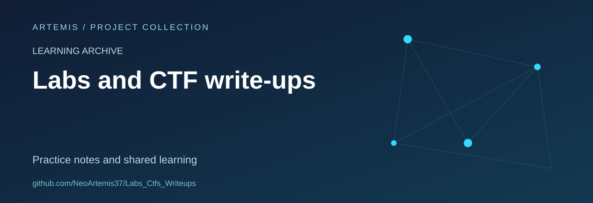

# Cybersecurity Labs and CTF Notes

A learning archive for lab notes, challenge write-ups and technical reflection across cybersecurity topics.

**Status:** an evolving personal notebook. The collection contains material with different levels of completeness; individual folders provide their own context.

## Repository map

| Folder | Contents |
| --- | --- |
| [`HTB_CyberApocalypse2026/`](HTB_CyberApocalypse2026/) | Event-specific challenge notes and artefacts |
| [`HTB_S12_AERO/`](HTB_S12_AERO/) | Hack The Box learning notes |
| [`ECHOCTF/`](ECHOCTF/) | EchoCTF material |
| [`ApplicationOfAI_In_Infosec/`](ApplicationOfAI_In_Infosec/) | Notes on AI and information security |
| `academy/` | Supporting learning data |
| `cylab/` | Laboratory research material |

## How I document learning

Useful write-ups explain the lab context, the observations that informed an approach, the difficulties encountered and the resulting defensive lessons. A note should distinguish verified results, historical output and points still to investigate.

The repository does not currently enforce a single report template across every file. Some artefacts are exploratory scripts rather than finished walkthroughs.

## Share and improve

Corrections, clearer explanations and alternative approaches are welcome. Please identify the relevant lab or challenge and preserve the authorship of third-party material.

## Scope and attribution

This collection records controlled practice and competition learning. It is separate from client reports and responsible-disclosure outcomes. Platform names describe the source of the exercise, not an endorsement.

No repository-wide licence file is currently included. Third-party challenge statements, files and platform material should retain their original terms and credits.
